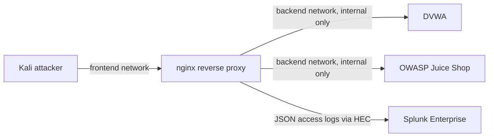
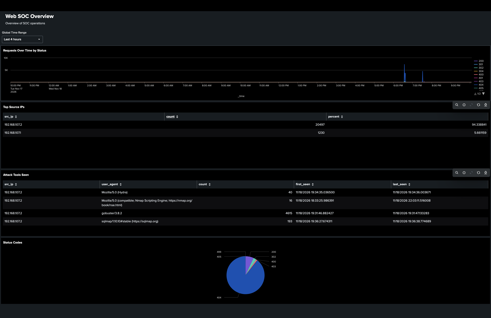
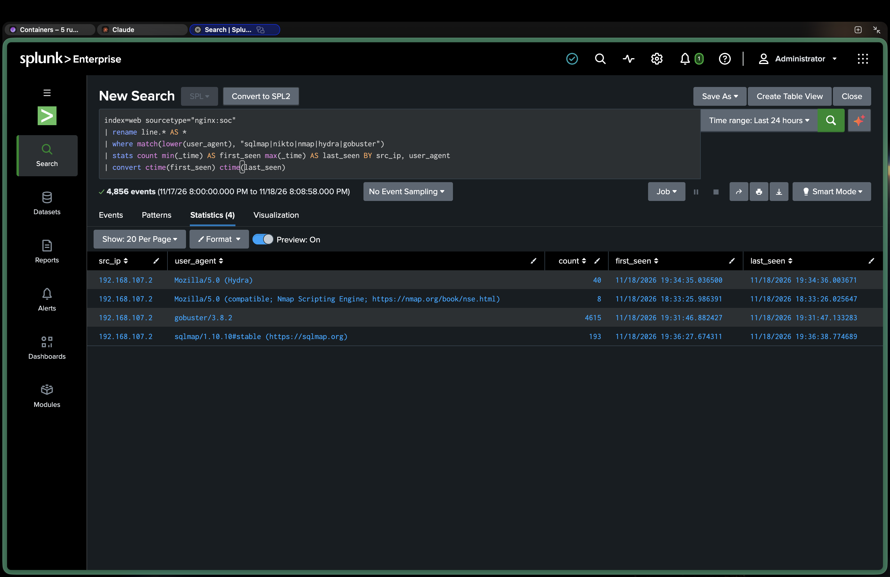
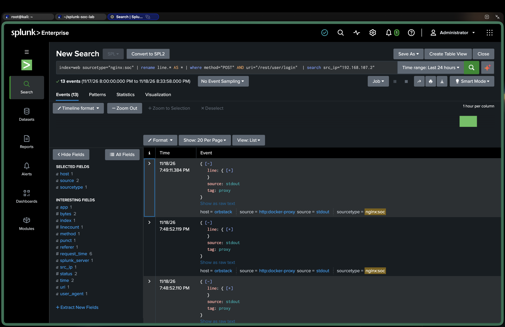

# Splunk SOC Home Lab (Docker and OrbStack)

A containerized Security Operations Center lab built on an Apple Silicon Mac. Kali Linux attacks two intentionally vulnerable web applications (DVWA and OWASP Juice Shop) through an nginx reverse proxy. Every request is logged as JSON and shipped to Splunk Enterprise through the HTTP Event Collector (HEC). I wrote SPL detections mapped to MITRE ATT&CK, built a dashboard, and documented the whole incident with a containment plan.

**Headline result:** one attacker source generated 20,497 requests (94% of all traffic) across eight attack techniques, and every one of them was detected in Splunk, including a SQL injection payload the logs could not directly see.

## Architecture



| Container | Role |
|---|---|
| splunk | SIEM (Splunk Enterprise), runs under Rosetta on Apple Silicon |
| proxy | nginx reverse proxy that logs every request as JSON |
| dvwa | Damn Vulnerable Web Application |
| juiceshop | OWASP Juice Shop |
| kali | Attacker |

The applications sit on an internal-only network. The attacker can only reach them through the proxy, the same way a real attacker would hit a public web server. That also means every attack request passes through the one place being logged.

**Why containers instead of VMs:** Splunk's official image is x86-64 only, and VMware Fusion on Apple Silicon couldn't run it. OrbStack runs the Intel image through Rosetta, and the whole lab is defined in one Compose file, so it can be rebuilt from this repo in minutes.

## Tools

Splunk Enterprise, HTTP Event Collector, Docker Compose, OrbStack, nginx, DVWA, OWASP Juice Shop, Kali Linux, Nmap, Nikto, Gobuster, Hydra, sqlmap

## Attacks Simulated

| # | Attack | Tool | Outcome | MITRE ATT&CK |
|---|---|---|---|---|
| 1 | Service scan | Nmap | Ports 8081 and 8082 open, nginx 1.31.9 | T1595.001 Active Scanning |
| 2 | Vulnerability scan | Nikto | 7,794 requests, 13 findings (missing headers, directory indexing, exposed `.gitignore`) | T1595.002 Vulnerability Scanning |
| 3 | Directory brute force | Gobuster | Mapped `config`, `docs`, `external`, `phpinfo.php` | T1595.003 Wordlist Scanning |
| 4 | Password guessing (DVWA) | Hydra | Recovered `admin` / `password` | T1110.001 Password Guessing |
| 5 | SQL injection (DVWA) | sqlmap | Injectable 4 ways; dumped `dvwa` and `information_schema` | T1190 Exploit Public-Facing Application |
| 6 | Reflected XSS (DVWA) | curl | `<script>alert(1)</script>` reflected back | T1059.007 / T1190 |
| 7 | Password guessing (Juice Shop) | curl | 12 failed logins (HTTP 401) | T1110.001 Password Guessing |
| 8 | SQL injection login bypass (Juice Shop) | curl | `' OR 1=1--` logged in as admin with no password | T1190 Exploit Public-Facing Application |

## Detections

All SPL is in the [`detections/`](detections) folder. Results are from the actual Splunk runs.

| Detection | File | Result |
|---|---|---|
| Web scanning (404 flood) | `01-web-scanning.spl` | Peak 7,401 not-found hits in one 5-minute window |
| Attack-tool user agents | `02-attack-tool-user-agents.spl` | 4 tools identified: gobuster (4,615), sqlmap (193), Hydra (40), Nmap (16) |
| SQL injection in URL | `03-sql-injection.spl` | 27 matching requests |
| Cross-site scripting in URL | `04-xss.spl` | 640 matching requests |
| DVWA password guessing | `05-dvwa-password-guessing.spl` | Hydra brute force against the login page |
| Juice Shop login abuse | `06-juiceshop-login-abuse.spl` | 13 login POSTs: 12 failures, then the bypass |
| Blocked requests (containment) | `07-blocked-requests.spl` | Verifies a proxy block once applied (see Containment) |







## Dashboard

The `Web SOC Overview` dashboard has four panels:

- **Requests Over Time by Status:** the scanning bursts show up as sharp spikes.
- **Top Source IPs:** 192.168.107.2 (the attacker) made 20,497 requests, 94.3% of all traffic. The rest came from 192.168.107.1, which is Docker gateway and health-check traffic.
- **Attack Tools Seen:** every tool, by user agent, with first-seen and last-seen times.
- **Status Codes:** dominated by HTTP 404, the signature of heavy scanning.

## Key Lessons

**Signature detections need triage.** Most of the SQL injection and XSS hits (27 and 640) came from Nikto throwing speculative probe payloads, not from a real exploit. An analyst still has to separate a scanner's thousands of guesses from the sqlmap run that actually confirmed and enumerated a working injection.

**Knowing your log blind spots matters.** The Juice Shop SQL injection was in the POST request body, which nginx access logs don't record. The URL-based SQLi rule could not see it. It was still caught behaviorally: a burst of failed logins followed by a success from the same source. Knowing where your data is blind is as important as writing the detections.

**User agents are a convenience, not a control.** The tools announced themselves, which made detection easy. A real attacker would spoof the user agent, so the behavior-based rules (404 rate, failed-then-success logins) are the ones that would hold up.

## Containment (Recommended)

The lab is built so the attacker can be cut off in one step. The recommended action is to block the attacker's IP at the nginx reverse proxy:

```
echo "deny 192.168.107.2;" > nginx/blocklist/kali.conf
docker compose exec proxy nginx -s reload
```

Then confirm the block in Splunk with detection 07, which should show HTTP 403 responses for that source. Blocking at the proxy works for both applications at once, because every request already passes through it. This step is planned but was not run during this exercise.

## Incident Report

The full analyst write-up, with timeline, detection results, analysis and response, is in [`reports/incident-report-web-attack.md`](reports/incident-report-web-attack.md).

## How to Run

1. `cp .env.example .env`, set `SPLUNK_PASSWORD` (8 or more characters), and set `HEC_TOKEN` to the output of `uuidgen`.
2. On Apple Silicon, turn on "Use Rosetta to run Intel code" in OrbStack, since the Splunk image is x86-64 only.
3. `docker compose up -d splunk` and wait until `docker ps` shows it as healthy (5 to 10 minutes on first boot).
4. Load the settings and create the index and HEC token:

```
set -a; source .env; set +a
curl -sk -u "admin:$SPLUNK_PASSWORD" https://localhost:8089/services/data/indexes -d name=web
curl -sk -u "admin:$SPLUNK_PASSWORD" -X POST https://localhost:8089/servicesNS/nobody/splunk_httpinput/data/inputs/http/http/enable
curl -sk -u "admin:$SPLUNK_PASSWORD" https://localhost:8089/servicesNS/nobody/splunk_httpinput/data/inputs/http -d name=docker-proxy -d token=$HEC_TOKEN -d index=web -d indexes=web
```

5. `docker compose up -d`
6. Splunk is at http://localhost:8000, DVWA at http://localhost:8081, Juice Shop at http://localhost:8082.

Only run the attacks against the containers in this lab.

## Skills Demonstrated

Log ingestion with HEC, SPL detection engineering, MITRE ATT&CK mapping, dashboarding, network segmentation, triaging signature versus behavioral detections, containment planning, and incident reporting.

## Next Steps

- Run the containment step and add the 403 evidence from detection 07
- Add ModSecurity as a web application firewall and compare what it blocks with what Splunk detects
- Log request bodies on login endpoints to close the POST-body blind spot
- Add a Linux SSH target and analyze its authentication logs
- Add a Windows endpoint with Sysmon for Windows Event ID detections
